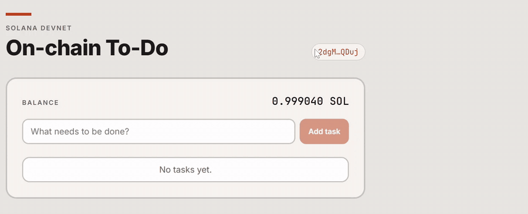

# On-chain To-Do List on Solana (Anchor + Rust)

A to-do list where every task lives on the Solana blockchain. Built with **Anchor 1.2.2** and **Rust**, tested with **LiteSVM**, deployed to **devnet**, and used from a small **React + Vite** front end with a **Codama**-generated client and **@solana/kit**.



**Full video tutorial on YouTube (19 min):** https://youtu.be/wM81Fdw7CPI

---

## What it does

| Instruction     | What happens on-chain |
|-----------------|-----------------------|
| `create_task`   | Creates a new account for the task at a PDA derived from the owner's wallet. The owner pays the rent deposit. |
| `update_task`   | Changes the description of an existing task. Only the owner can do it. |
| `complete_task` | Marks the task as completed. Fails if it's already completed. |
| `delete_task`   | Closes the task account and sends the rent deposit back to the owner's wallet. |

Program ID on devnet: `21PCzXqHSYU8njPER9o7FQfT38512wrSrPpdy8fMbSa9`

## How the data is stored

Solana programs are stateless: the data lives in separate **accounts** owned by the program. Each task is its own account:

```rust
#[account]
#[derive(InitSpace)]
pub struct Task {
    pub owner: Pubkey,
    pub task_id: u64,
    #[max_len(MAX_DESCRIPTION_LEN)] // 280 bytes
    pub description: String,
    pub completed: bool,
    pub bump: u8,
}
```

- **Address (PDA):** derived from the seeds `["task", owner, task_id]` plus the program ID. The same user and the same ID always lead to the same task, so there's no index and no lookup table. A PDA has no private key, so only the program can sign for it.
- **Space:** `8` bytes for the Anchor discriminator + `Task::INIT_SPACE`. The description space is reserved up front, so editing it never needs a realloc.
- **Rent:** the owner pays a deposit when the task is created, and gets it back when the task is deleted (`close = owner`).

## Security checks

- `has_one = owner` and the `seeds` constraint on every instruction that changes a task: only the wallet that created it can edit, complete or delete it.
- Custom errors with `require!`: empty description, description over 280 bytes, task already completed.

## Tests (LiteSVM, in Rust)

The tests run the compiled program inside a fast in-process Solana runtime:

- `owner_can_create_edit_complete_and_delete`: the full happy path, including the rent coming back after delete
- `another_wallet_cannot_edit_my_task`: an attack from another user, which must fail
- `description_over_280_bytes_fails`
- `completing_twice_fails`

## Project structure

```
programs/todo/
  src/
    lib.rs                 # program entry point and instructions
    constants.rs           # TASK_SEED, MAX_DESCRIPTION_LEN
    error.rs               # custom errors
    state/task.rs          # the Task account
    instructions/          # create_task, update_task, complete_task, delete_task
  tests/test_todo.rs       # LiteSVM tests
app/                       # React + Vite front end
  src/generated/           # client generated from the IDL with Codama
  src/todo.ts              # RPC calls and transactions with @solana/kit
  src/TodoList.tsx         # the UI
```

## Running it

### Requirements

- Rust (the toolchain is pinned in `rust-toolchain.toml`)
- Solana CLI 3.x (Agave) and Anchor CLI 1.2.2 (via `avm`)
- Node.js 24 and npm
- A wallet such as Phantom, set to devnet

### Program

```bash
anchor build
anchor test          # runs the LiteSVM tests (cargo test)
```

To deploy your own copy, use your own program ID:

```bash
anchor keys sync     # writes your program keypair's address into lib.rs and Anchor.toml
anchor build
solana airdrop 2 --url devnet
anchor deploy        # the cluster is set to devnet in Anchor.toml
```

### Front end

```bash
cd app
npm install
npx codama run js    # regenerates the client from target/idl/todo.json
npm run dev
```

Open the local URL, connect your wallet on devnet, and add a task. The RPC endpoint defaults to `https://api.devnet.solana.com` and can be changed with `VITE_RPC_URL`.

---

Made by Fernando Santos · [YouTube tutorial](https://youtu.be/wM81Fdw7CPI) · [LinkedIn](https://www.linkedin.com/in/fernando-blockchain)
